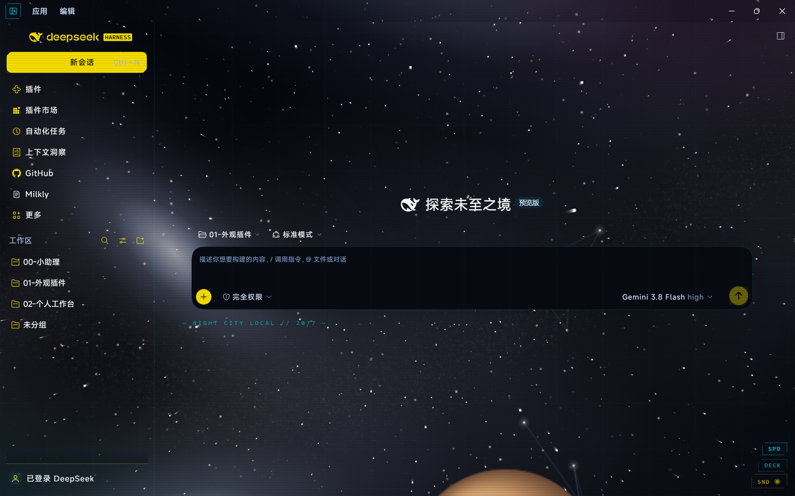
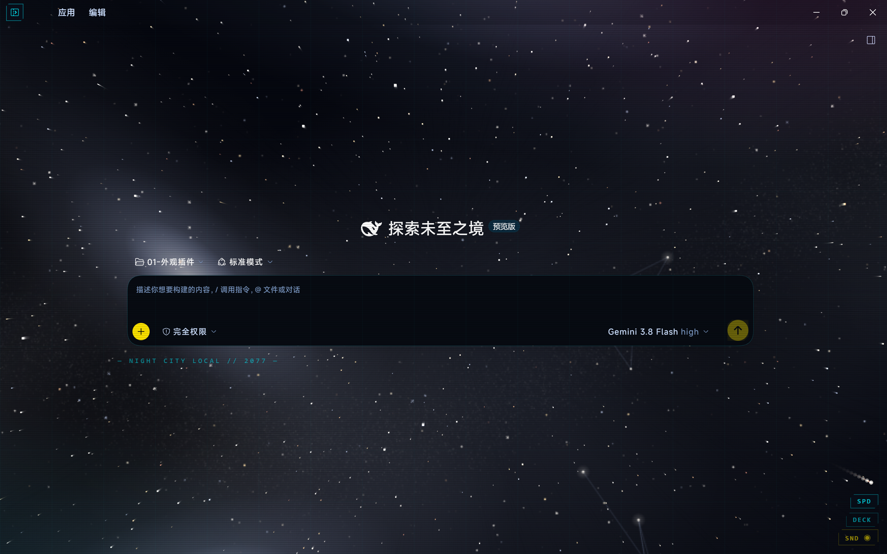
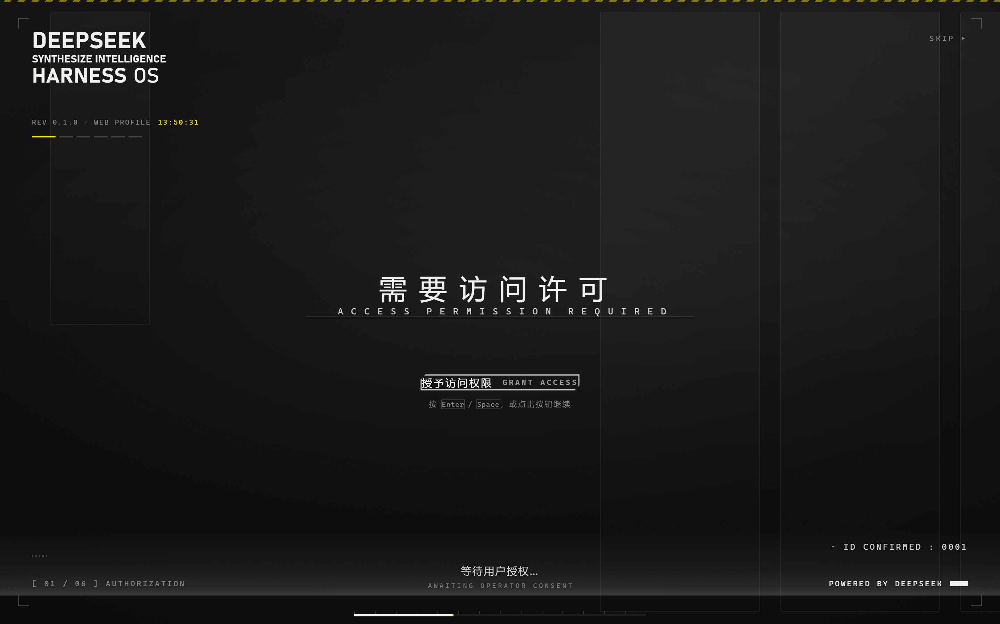
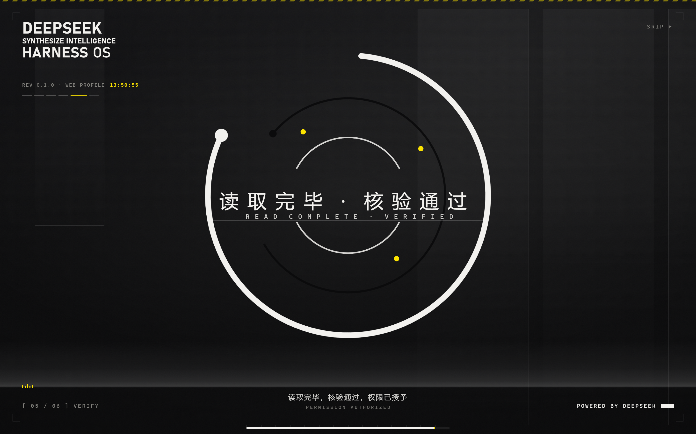

# Starlight Protocol (星轨协议 2077)

<div align="center">

[](LICENSE)
[](https://github.com/milkly909-code/dsh-plugin-starlight-protocol)
[](https://github.com/milkly909-code/dsh-plugin-starlight-protocol)
[](https://github.com/milkly909-code/dsh-plugin-starlight-protocol)

<p align="center">
  <strong>DeepSeek Harness 综合外观与交互增强套件</strong><br>
  全域动态深空天体引擎 × 赛博朋克 2077 战术 HUD × 特工冷启动鉴权序列 × 战术侧栏折叠修复
</p>

</div>

---

## 📸 界面预览 (Interface Previews)

### 1. 应用主界面 (Application UI)

星轨协议重构了 DeepSeek Harness 视觉系统。在窗口底层注入无缝深空流动天体星幕，界面组件采用高对比度赛博朋克夜之城配色（霓虹青 × 战术金），并修复了无边框环境下侧栏收起后的折叠按钮丢失问题。

#### 侧边栏展开状态 (Full Workspace View)
展示完整侧边栏导航、搜索卡片、中央对话台与右下角 HUD 状态读数：

<div align="center">
  
</div>

<br>

#### 侧边栏折叠状态 (Immersive Focused View)
点击左上角战术切角折叠按钮一键隐藏侧栏，进入宽屏沉浸模式：

<div align="center">
  
</div>

---

### 2. 开机冷启动序列 (Startup Sequence)

应用启动时自动触发独立的特工鉴权动效，由黑幕序幕平滑过渡至特工身份确认。

| 序幕阶段 (Blackout & Reticle) | 鉴权阶段 (Identity & Authorization) |
| :---: | :---: |
|  |  |
| 官方矢量鲸鱼标识准星瞄准扫描 | 机密特工档案卡、动态进度条与授权按钮 |

---

## ⚡ 核心功能 (Features)

### 🌌 1. 全域深空动态天体引擎 (Deep Space Engine)
* **无缝流动星幕**：整周期正弦银河带算法，自动偏航巡航漂移与鼠标 3D 阻尼视差。
* **正交 3D 星座网络**：动态随机生成的星座骨架网络与多阶光谱级恒星光斑。
* **三档天体航速 (SPD)**：
  * `0.12x`（巡航档 · 缓慢巡航，舒适防眩）
  * `0.25x`（动力档 · 2倍平稳推进）
  * `0.96x`（折跃档 · 8倍高速流线光束）

### ⚡ 2. 赛博朋克 2077 战术 HUD 终端 (HUD Theme)
* **高对比度视觉重构**：霓虹青（`#00f0ff`）× 战术金黄（`#fce300`）× 深空玄黑底层。
* **机能切角轮廓**：全组件工业战术切角（`clip-path`）、CRT 扫描线与细节边角。
* **现场音频合成**：基于 Web Audio API 现场合成机械交互音效，无需加载外部音频文件。
* **彩蛋模式**：内置专属彩蛋交互，提供沉浸式终端质感。

### 🎛️ 3. 战术侧栏隐藏总控 (Sidebar Controller · 核心修复)
* **解决原生折叠缺陷**：解决 Windows 无边框定制环境下侧边栏收起后按钮丢失的问题。
* **高优先级切角微光按钮**：固定于左上角操作区（`z-index: 10050`），不受窗口拖拽区域拦截。
* **双态联动**：展开态向内折叠 `◀`，折叠态向外展开 `▶`，直接调度 DSH 官方 `layout.toggleSidebar()` 原生接口，安全稳定零崩溃。

### 🚀 4. 特工冷启动鉴权序列 (Startup Screen)
* **黑客特工档案**：开机加载特工机密身份卡片（代号、权限等级与数字流）。
* **交互式快速接入**：支持回车、空格或鼠标点击「授予访问权限」快速切入工作台。
* **自适应与可配置**：支持在设置中配置自定义身份名称与播报选项。

---

## 📦 安装与启用 (Installation)

### 方式一：DSH 插件管理器一键接入 (推荐)

在命令行中执行：

```bash
dsh plugin --profile desktop add dsh-plugin-starlight-protocol
```

### 方式二：Cordis 配置挂载

在 DeepSeek Harness 的 `cordis.patch.yml` 中追加：

```yaml
- insert:
    id: dsh-plugin-starlight-protocol
    name: dsh-plugin-starlight-protocol
```

保存后重启 DeepSeek Harness 或在窗口中按下 `Ctrl + R` 刷新生效。

---

## ⚙️ 模块设置 (Settings)

安装后，DeepSeek Harness「设置 (Settings)」面板将自动注册专属的 **「星轨协议」** 控制分区：

* **深空天体引擎**：独立开关与航速预设
* **赛博朋克 HUD**：主题色系与扫描线样式调节
* **开机动画序列**：启闭控制、播报语言与身份信息定制

所有设置支持热更新，修改后即时生效。

---

## 🛡️ 安全与隐私保障 (Privacy & Security)

* **零数据外泄**：纯本地运行，不收集、不上传任何个人文件、工作区路径、代码或聊天内容。
* **零外部 CDN 依赖**：所有样式、矢量图标及动效逻辑均打包在本地沙箱中运行，离线可用。
* **性能友好**：针对低功耗环境做了平滑降帧优化，自动遵循系统 `prefers-reduced-motion` 设置。

---

## 📁 项目结构 (Structure)

```
dsh-plugin-starlight-protocol/
├── assets/                  # 官方实机演示截图
│   ├── app-expanded.png     # 侧边栏展开状态实机图
│   ├── app-folded.png       # 侧边栏折叠状态实机图
│   ├── startup-intro.png    # 开机冷启动序幕图
│   └── startup-auth.png     # 特工档案与鉴权交互图
├── cordis.patch.yml         # DSH 核心服务注册编排文件
├── package.json             # 插件元数据与入口配置
├── README.md                # 插件文档
├── SKILL.md                 # 智能体规范定义
├── LICENSE                  # MIT 开源许可
└── lib/
    ├── client.js            # 前端综合 Bundle (深空引擎 + HUD 主题 + 折叠按钮 + 设置面板)
    ├── index.js             # 后端配置服务与 API 路由
    ├── splash.js            # 开机冷启动动效逻辑
    └── splash.css           # 开机界面样式
```

---

## 🙏 致谢与上游开源项目 (Acknowledgements & Upstream)

星轨协议 2077（Starlight Protocol）是一套深度定制与二次开发的综合外观增强系统。我们由衷感谢以下优秀开源项目为社区带来的灵感与技术基石：

- **[dsh-theme-cyberpunk2077](https://github.com/Tommy00748/dsh-theme-cyberpunk2077)** (by [@Tommy00748](https://github.com/Tommy00748)) — 提供了出色的赛博朋克 2077 夜之城 HUD 终端视觉体系与配色基底。
- **[dsh-startup-screen](https://github.com/6shenhonghong9/dsh-startup-screen)** (by [@6shenhonghong9](https://github.com/6shenhonghong9)) — 提供了特工冷启动序列与鉴权动效的核心框架。
- **[dsh-space-background](https://github.com/milkly909-code/dsh-space-background)** (by [@milkly909-code](https://github.com/milkly909-code)) — 提供了底层全域深空动态天体引擎。

本项目在遵循 MIT 开源许可证的前提下，对上述模块进行了底层重构、视觉统一与性能调度整合，并针对 Windows 无边框定制环境**自主研发补齐了「战术侧栏隐藏/展开总控（`#starlight-sidebar-toggle`）」**及专属独立控制分区，使三个独立模块组合为统一配置与协同运行的一体化外观套件。

---

## 📜 开源协议 (License)

本项目基于 [MIT License](LICENSE) 开源发布。详细上游第三方版权声明参见 [LICENSE](LICENSE) 文件。
