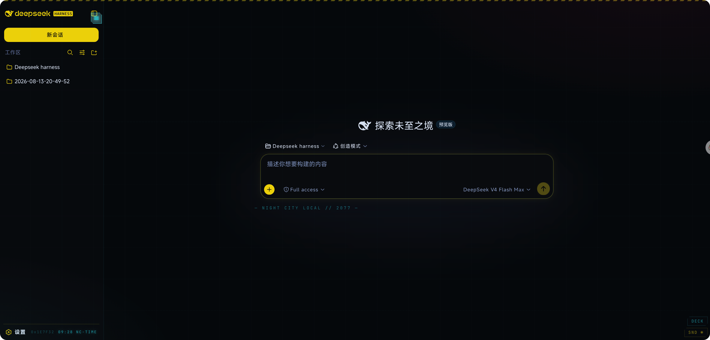
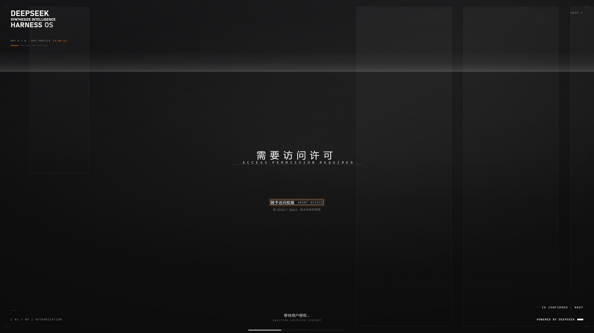
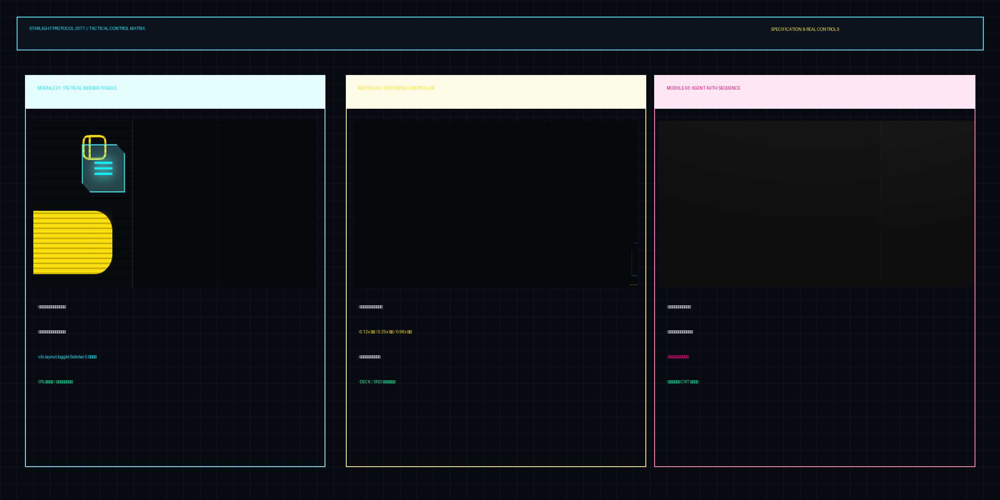

# 星轨协议 2077 (Starlight Protocol)

<div align="center">

[](LICENSE)
[](https://github.com/milkly909-code/dsh-plugin-starlight-protocol)
[](https://github.com/milkly909-code/dsh-plugin-starlight-protocol)
[](https://github.com/milkly909-code/dsh-plugin-starlight-protocol)

<p align="center">
  <strong>「WAKE UP, SAMURAI. 欢迎接入星轨协议 2077。」</strong><br>
  为 DeepSeek Harness 量身打造的旗舰级综合外观系统<br>
  深空天体引擎 × 赛博朋克 HUD × 开机鉴权序列 × 战术侧栏总控 · 四合一自主矩阵
</p>

</div>

---

## 🖥️ 实际应用主界面效果 (Application Interface)

> **实机渲染效果**：深空正交星座与流动天体星幕穿透窗口底层，赛博朋克 2077 夜之城 HUD 霓虹青战术切角轮廓包覆工作区，左上角无缝集成战术侧栏折叠按钮，右下角常驻航速读数与芯片控制器。

<div align="center">
  
</div>

---

## 🌟 核心特性全景

### 1. 🌌 全域深空动态天体引擎 (Deep Space Horizon)
- **360° 无缝流动星幕**：整周期无缝正弦银河带算法，自动偏航巡航漂移与鼠标 3D 阻尼视差。
- **正交 3D 星座网络**：动态随机生成的星座骨架网络与 6 阶光谱级恒星光斑。
- **光环行星公转与流星**：光环行星轨道公转，随机穿梭折跃流星。
- **右下角 SPD 三档航速控制器**：
  - **巡航档 (Cruise)**：`0.12x`（星系缓慢巡航，护眼防眩）
  - **动力档 (Boost)**：`0.25x`（2倍巡航推进）
  - **折跃档 (Warp)**：`0.96x`（8倍超光速折跃，星轨流线光束）

---

### 2. 🚀 开机冷启动认证序列 (Startup Sequence)

> **实际开机效果**：冷启动时触发黑幕认证序列、过曝白光与 CRT 荧光屏平滑展开。特工档案卡片、官方鲸鱼瞄准准星扫描、动态进度条与实机交互授权按键。

<div align="center">
  
</div>

- **黑幕鉴权过场**：深空冷启动时触发黑幕认证序列，平滑过渡至特工档案底板。
- **机密特工档案卡**：黑客特工身份档案（代号、权限等级与数字流），支持自定义身份。
- **动态雷达与授权交互**：环形准星扫描瞄准、全宽动态进度条、支持键盘/鼠标点击「授予访问权限」快速接入。
- **神经网络真声念白**：内置高质量语音念白与 Web Speech 语音回退保障。

---

### 3. ⚡ 赛博朋克 2077 战术 HUD 终端 (Cyberpunk 2077 HUD Theme)
- **夜之城色调矩阵**：霓虹青（`#00f0ff`）× 战术金黄（`#fce300`）× 深空玄黑底层，高对比度视觉重构。
- **战术切角与 HUD 框架**：全组件战术切角轮廓（`clip-path`）、CRT 细腻扫描线、细节角标包角。
- **声效与交互反馈**：纯代码 Web Audio API 合成机械打字音效（零外部音频依赖），右下角 `SND` 音效开关与 `DECK` 控制抽屉。
- **Relic 故障彩蛋**：输入框输入特定暗号（如 `relic` 或 `johnny`）触发强尼·银手夺屏故障扫描与色散撕裂。

---

### 4. 🎛️ 战术侧栏隐藏总控与控件矩阵 (Tactical Controls)

> **细节特写**：左上角无边框定制环境下新修复的战术侧栏折叠按钮、右下角 SPD 天体航速控制器与特工鉴权序列。

<div align="center">
  
</div>

- **彻底修复侧栏折叠按钮丢失问题**：在 Windows 无边框定制环境下解决原生折叠按钮丢失缺陷，高优先级切角微光按钮固定于左上角（`z-index: 10050`），不受拖拽区域拦截。
- **双态智能矢量图标**：
  - **展开态 (显示侧栏)**：显示向内折叠箭头 `◀` 与实线面板框，悬停提示 `收起侧边栏 (Ctrl+B)`。
  - **折叠态 (隐藏侧栏)**：显示向外展开箭头 `▶` 与虚线导轨框，悬停提示 `展开侧边栏 (Ctrl+B)`。
- **多级稳态调度**：直接驱动 DSH 官方 `layout.toggleSidebar()`，自动避让品牌 Logo，零崩溃风险。

---

### 5. 🎚️ 模块矩阵总控面板 (Master Module Matrix)
- 在 DSH「设置 (Settings)」左侧栏自动注册专属「星轨协议 (Starlight)」配置分区。
- 提供深空背景、主题、开机动画的独立启闭开关，配置保存即时热更新生效。

---

## ⚡ 快速安装与配置

### 方式一：DSH 插件管理器一键接入 (推荐)

在终端中执行以下命令快速安装：

```bash
dsh plugin --profile desktop add dsh-plugin-starlight-protocol
```

### 方式二：手动配置 (Cordis 编排)

在 DSH 用户配置目录的 `cordis.patch.yml` 中追加挂载项：

```yaml
- insert:
    id: dsh-plugin-starlight-protocol
    name: dsh-plugin-starlight-protocol
```

重启 DeepSeek Harness 或在窗口中按下 `Ctrl + R`，欢迎接入夜之城星轨协议！

---

## 🛡️ 性能与隐私安全保障

- **零隐私外泄**：所有组件均在本地沙箱运行，不搜集、不上传任何个人文件、工作区路径或聊天内容。
- **小屏自适应**：在移动端或窄屏环境（≤768px）下自动关闭高耗能扫描线与背景流线。
- **减弱动态效果支持**：遵循系统 `prefers-reduced-motion` 设置，开启时平稳收敛高帧率过渡。
- **一键静音与特效开关**：界面右下角常驻 `SND` 静音按键与 `DECK` 控制器，所有特效可独立一键关闭。

---

## 📁 项目结构

```
dsh-plugin-starlight-protocol/
├── assets/               # README 实机高清演示截图
│   ├── starlight-hero.png       # 实际应用主界面效果截图
│   ├── starlight-startup.png    # 实际冷启动特工鉴权开机截图
│   └── starlight-controls.png   # 战术折叠按钮与核心控制展示
├── cordis.patch.yml      # DSH 核心服务注册编排文件
├── package.json          # 插件元数据与入口声明
├── README.md             # 工程主文档
├── SKILL.md              # AI Agent 智能体技能标准规范
├── LICENSE               # MIT 开源授权协议
└── lib/
    ├── client.js         # 前端综合 Bundle (深空引擎 + HUD 主题 + 折叠总控 + 设置面板)
    ├── index.js          # 后端配置服务与 API 路由
    ├── splash.js         # 开机冷启动动效逻辑
    ├── splash.css        # 开机黑幕与认证卡片样式
    └── assets/           # 音频素材与 Relic 彩蛋图片
```

---

## 📜 开源协议

本项目基于 [MIT License](LICENSE) 开源。
